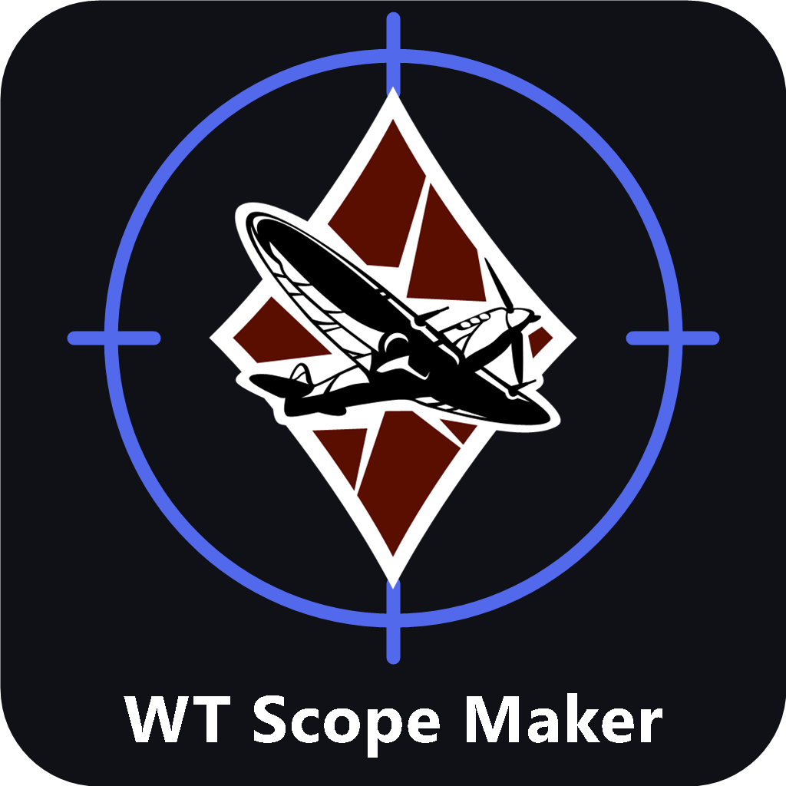

# War Thunder Scope Maker



Редактор пользовательских танковых прицелов War Thunder для Windows: рисование сетки, импорт рисунков, игровые шаблоны и фоны, экспорт BLK.

**Готовая программа:** откройте раздел **Releases**, скачайте ZIP или EXE последней версии и распакуйте его целиком. Для запуска используйте `War Thunder Scope Maker.exe` из распакованной папки.

Windows editor for custom War Thunder tank sights. Draw reticles, convert artwork into sight geometry, use templates and preview backgrounds, and export BLK files. Russian and English UI. Download the portable ZIP from **Releases**, extract all files, and run `War Thunder Scope Maker.exe`.


**0.8.1 — pre-alpha · Windows · русский / English**

Запуск: `dist-0.8.1/War Thunder Scope Maker.exe` (в ZIP — прямо из распакованной папки). Установка и подключение к интернету не нужны. Требуется Windows с .NET Framework 4.x Это экспериментальная версия, возможны ошибки.

## Что изменилось в 0.8.1

- Видимые полосы прокрутки снизу и справа; пробел + мышь или средняя кнопка перемещают сцену. Shift + колесо — горизонтально, Alt + колесо — вертикально, Home — в центр.
- Новые проекты и BLK получают последовательные имена scope_1, scope_2 и далее.
- Установщик WT-Scope-Maker-Setup-0.8.1.exe устанавливает и обновляет программу без прав администратора, сохраняя настройки и проекты. Перед обновлением закройте приложение. ZIP остаётся portable-вариантом.
- Пройдено 83 проверки приложения и проверки установки, обновления и сохранности пользовательских файлов.
- Подробности: [RELEASE-0.8.1.md](docs/RELEASE-0.8.1.md).

## Что изменилось в 0.7

- Ластик на верхней панели (E): размер кисти 4–160 экранных пикселей справа. Стираются участки линий и окружностей, залитых фигур и импортированных рисунков; текст удаляется как объект кнопкой корзины. Скрытые слои не затрагиваются. Один проход — один шаг отмены, Esc отменяет незавершённое стирание. Вырезанные участки сохраняются в проекте и экспорте BLK.
- Рисунок можно увеличивать и уменьшать кнопками в свойствах, числовой шириной, Ctrl + колесом или маркером в правом нижнем углу выделения. Пропорции сохраняются, положение центра остаётся прежним. Обычное колесо меняет общий масштаб предпросмотра.
- Импорт загружает файл и пересчитывает результат в фоне. Быстрое изменение настроек отменяет устаревший пересчёт; добавить можно только актуальный результат.
- Детализация до 2048 пикселей, выбор более компактного разбиения на прямоугольники и автоматический подбор детализации под оставшийся лимит фигур проекта. Если детализация уменьшена, это явно указано в окне импорта; автоматический подбор можно отключить.
- Режим «Неравномерный фон» помогает выделять штрихи на бумаге с градиентом освещения. В этом режиме ручной порог регулирует чувствительность локального выделения. Для обычных логотипов и залитых рисунков сначала используйте стандартный режим.
- Большие исходники предварительно ограничиваются 4096 пикселями по длинной стороне. Предел загрузки — 64 мегапикселя и 256 МБ на файл. Итог остаётся одноцветной геометрией с ограничением 20 000 фигур; фотографии не превращаются в полноцветные текстуры.

## Что изменилось в 0.6.3

- Автоматический поиск `UserSights` в системной папке «Документы» (включая перенесённую папку): `My Games\WarThunder\Saves\<профиль>\production\UserSights`. При нескольких профилях экспорт предлагает выбрать аккаунт и запоминает выбор. Если есть `all_tanks`, окно экспорта открывается в ней; иначе — в `UserSights`, где можно выбрать папку техники. Вручную заданная папка имеет приоритет.
- В настройках добавлена кнопка «Найти папку WT». Если папка прицелов ещё не создана, программа сообщает об этом и оставляет ручной выбор доступным.
- Состояние проекта сравнивается с последним успешным сохранением. Выбор слоя, обновление свойств, масштаб и отмена до сохранённого состояния не вызывают лишний вопрос при закрытии. Новые правки по-прежнему требуют сохранения.
- Пройдено 56 автоматических проверок, включая несколько профилей, отсутствие папок, сохранение, повторное открытие и undo/redo относительно сохранённой версии.

## Что изменилось в 0.6.2

- Логотип заменён на предоставленную пользователем эмблему самолёта внутри перекрестия с подписью «WT Scope Maker» внизу. Обновлены шапка, PNG, SVG и значок Windows.

## Что изменилось в 0.6

- Новый логотип: оригинальная надпись War Thunder внутри перекрестия. Добавлены PNG 1024×1024, SVG и многоразмерный значок Windows; логотип отображается в шапке и значке EXE.
- Настройки открываются шестерёнкой в верхней строке или через «Файл → Настройки».
- Светлая и тёмная темы, семь готовых акцентов и произвольный цвет. Цвет текста основной кнопки подбирается для контраста.
- Русский и английский интерфейсы, включая галерею фонов, конвертер рисунка, меню, подсказки и сообщения. Смена языка применяется сразу; пользовательский текст и содержимое проекта сохраняются. Стандартные диалоги Windows используют язык системы.
- Папка экспорта по умолчанию: выбор через диалог, ввод пути и сброс. Она задаёт стартовую папку обычного окна экспорта BLK.
- Настройки сохраняются в `settings.json` рядом с EXE и восстанавливаются при запуске. Распакуйте приложение в доступную для записи папку; настройки не входят в файл проекта.
- Проверены сохранение и повторное чтение настроек, смена языка туда и обратно без изменения проекта и истории, вспомогательные окна и контраст акцентов. Всего 52 автоматические проверки.

## Что изменилось в 0.5

- Новый светлый интерфейс с нейтральными панелями, скруглёнными кнопками, векторными иконками и одним цветовым акцентом.
- Инструменты рисования вынесены наверх. Название и горячая клавиша появляются при наведении; файл, импорт и экспорт собраны в верхней строке.
- Слева — вкладки «Элементы» и «Шаблоны». В библиотеке работает поиск, основные игровые сетки получили понятные подписи.
- Справа показываются только свойства выбранного типа элемента. Редкие настройки доступны в разделе «Параметры WT».
- Галерея фонов и конвертер изображений оформлены в том же стиле. Окна автоматически вписываются в рабочую область экрана.
- Подробности управления: `docs/INTERFACE.md`.

## Что изменилось в 0.4.1

- Колесо мыши и поле масштаба приближают фон и сетку вместе относительно центра холста, в диапазоне 25–400%. При увеличении фон обрезается границами холста. Масштаб предпросмотра не меняет проект или экспортируемый BLK.

## Что изменилось в 0.4

- Добавлены фоны штатного редактора WT: пустыня, город, поле и снег; для каждой сцены есть день, ночь, ПНВ и тепловизор — 16 фонов в 3840×2160.
- Кнопка «Фон…» теперь открывает галерею с миниатюрами и большим предпросмотром. Выберите сцену, режим и нажмите «Применить».
- Есть затемнение, отключение сетки редактора, свой файл и вариант без фона. Встроенные фоны по умолчанию показываются без затемнения, целиком, с сохранением пропорций.
- Выбор фона, затемнение и состояние сетки сохраняются в проекте и поддерживают Ctrl+Z / Ctrl+Y. В экспорт BLK фон не попадает.
- Для работы галереи папка `assets` должна находиться рядом с EXE; распакуйте ZIP целиком.

## Что изменилось в 0.3

- Добавлены 66 штатных сеток из локального War Thunder 2.59.0.86; в списке шаблонов они начинаются с «WT ·». Папка `templates` должна лежать рядом с EXE.
- Исправлена ось Y: предпросмотр, рисование и экспорт картинок используют направление вниз, как в BLK. Старые проекты переводятся автоматически с сохранением видимого расположения.
- Параметры WT внизу правой панели: толщина элемента, выравнивание и подсветка текста, система тысячных, стандартная горизонталь/вертикаль.
- При импорте больше не дописываются не заданные в исходнике `move=no` и другие значения по умолчанию. Сохраняется более высокая точность координат.
- Строки читаются и экспортируются по правилам Dagor: поддерживаются буквальный обратный слеш, одинарные кавычки и экранирование через `~`.
- Пресеты интерфейса из `tank_sight_presets` распознаются отдельно от геометрии и сопровождаются объяснением.
- Основание решений и источники: `docs/WAR_THUNDER_FORMAT.md` в исходниках.

## Что работает

- Три авторских стартовых шаблона плюс 66 сеток из установленной игры.
- Рисование мышкой: линии, окружности, контурные и залитые прямоугольники, залитые треугольники и карандаш. Черновик фигуры виден до отпускания мыши. Каждый жест отменяется через Ctrl+Z.
- Линии, окружности/дуги, текст; числовые координаты, перемещение мышкой, дублирование, удаление, скрытие. Импортированные фигуры и треугольники также можно двигать мышкой.
- Общий цвет, толщина, экранные координаты или тысячные, флаг движения с поправкой.
- Фоновый скриншот и масштаб холста (фон и вспомогательная сетка не экспортируются).
- Сохранение/открытие проектов `.wtsm`, отмена/повтор (Ctrl+Z / Ctrl+Y), Ctrl+S.
- Импорт и экспорт текстовых `.blk`. Дополнительные параметры и баллистические блоки сохраняются, но не редактируются визуально. Комментарии и исходное форматирование при экспорте не сохраняются. Бинарные BLK не поддерживаются.
- Импорт PNG/JPG/BMP с окном сравнения исходника и результата: детализация 128/256/512/768/1024/1536/2048 пикселей по длинной стороне (по умолчанию 512, маленькие исходники не увеличиваются). Автоматический порог по гистограмме или ручной порог; тёмный рисунок, светлый рисунок, силуэт по прозрачности. Есть обрезка пустых полей и удаление изолированных компонентов из 1–2 пикселей. По умолчанию очистка отключена, чтобы не потерять мелкие детали.
- Соседние пиксели объединяются в прямоугольники `drawQuads` без изменения полученной бинарной маски. На холсте и в проекте весь рисунок — один объект: перемещайте его мышкой и меняйте «Ширину рисунка» справа. При экспорте в BLK он разворачивается в фигуры; повторный импорт BLK не восстанавливает группировку. Цвет изображения не сохраняется, используется общий цвет сетки.
- Ограничение: 20 000 экспортируемых элементов. Если рисунок слишком сложный, уменьшите детализацию либо включите очистку. Качество ограничено исходником: увеличение настройки не восстановит отсутствующие детали.

## Рисование и импорт рисунка

Выберите инструмент на верхней панели, зажмите левую кнопку и протяните мышь от начала к концу. Окружность задаётся ограничивающим квадратом, а не радиусом от центра. Shift выравнивает линию по горизонтали/вертикали и делает прямоугольник квадратным. «Привязка к сетке» округляет координаты к шагу 0.05. Карандаш создаёт последовательность коротких линий, не распознаёт геометрические объекты. Контурный прямоугольник состоит из четырёх отдельных линий.

Esc отменяет текущий черновик и возвращает инструмент выбора. В режиме выбора можно перетаскивать элементы. Прямоугольник, созданный заливкой, меняет форму через координаты начала/конца справа. Произвольные импортированные четырёхугольники и треугольники пока можно только перемещать, скрывать и дублировать.

«Импорт рисунка…» открывает настройки распознавания. Сначала попробуйте автоматический режим. Для белого логотипа на чёрном фоне выберите «Светлый рисунок»; для прозрачного PNG — «Силуэт по прозрачности». Чтобы вернуть слабые штрихи, отключите «Автопорог» и уменьшите порог. Результат является одноцветным силуэтом, фотографии и цветные градиенты не сохраняются как в оригинале. Число фигур и результат видны до добавления в проект.

## Первые шаги

1. Запустите EXE. Слева откройте «Шаблоны» и нажмите «Использовать шаблон» либо импортируйте существующий `.blk` кнопкой «Импорт».
2. Выберите элемент в списке слева. Меняйте параметры справа или тяните линию/точку начала элемента на холсте.
3. Сохраните проект `.wtsm`, чтобы продолжить работу позже.
4. Экспортируйте `.blk` в выбранную папку. Программа не изменяет файлы игры автоматически.
5. Для установки поместите файл в `Documents\My Games\WarThunder\Saves\<user ID>\production\UserSights\<vehicle ID>\` либо `all_tanks`. Для универсальных прицелов может понадобиться настройка `matchExpClass` в BLK. Выберите сетку в настройках прицела игры. Для обновления на пробном выезде документация указывает Alt+F9.

Документация формата: https://wiki.warthunder.com/cdk/creation_sight

## Ограничения предпросмотра

Предпросмотр приблизительный. Баллистика, зависимость от зума конкретного танка, вращающиеся элементы, игровые шрифты и эффекты подсветки полностью не эмулируются. Коэффициент 0.04 для тысячных — приблизительный. Флаг движения сохраняется в файл, но не анимируется на холсте. Размер/направление дуг требуют проверки в игре. Не следует использовать видимые расстояния на холсте как подтверждённую баллистическую разметку.

Встроенный фон сохраняется по идентификатору сцены и режима; собственный — ссылкой на файл. При перемещении собственного изображения его нужно выбрать заново. Старые `.wtsm` версии 0.1 открываются в новой программе; проекты с группированными рисунками поддерживаются. После сохранения в формате 2 проект требует версии 0.3 или новее. Для сложных BLK возможны неполное отображение и потеря специфичного поведения при редактировании известных полей: работайте с копиями.

## Сборка и проверки

Исходники: `src/ScopeMaker.cs`, `src/Drawing.cs`, `src/ImageImport.cs`, `src/GameCompatibility.cs`; проверки: `src/FeatureTests.cs` и `Compatibility.TestLibrary`. В PowerShell из корня проекта:

```powershell
.\build.ps1
& '.\dist-0.8.1\War Thunder Scope Maker.exe' --self-test "$PWD\test-results.txt"
& '.\dist-0.8.1\War Thunder Scope Maker.exe' --screenshot "$PWD\preview.png"
& '.\dist-0.8.1\War Thunder Scope Maker.exe' --import-screenshot "$PWD\image-import-preview.png"
```

Сборка использует системный компилятор .NET Framework, без NuGet. Программа не является продуктом Gaijin и не связана с разработчиком игры.
